# LikeThis

**Show an assistant a task. Keep the recording and review it when you are ready.**

<p align="center"></p>

LikeThis is a local workspace for recording tasks, organizing them by app and task, and reviewing recordings with an assistant you connect. The source package is `likethis`; the public repository is [wspotter/LikeThis](https://github.com/wspotter/LikeThis). Existing `holdmybeer` command and `mcp_servers.holdmybeer` client configuration names remain supported.

## The user flow

1. In **Start**, record a task in the browser or import a video, then name its app and task.
2. Save the recording. It appears in **Saved tasks** with its version history.
3. Review the recording yourself, or copy the task-specific review request to an assistant connected through MCP. The assistant must inspect the recording and submit a separate proposal.
4. Inspect the proposal in LikeThis and decide whether it accurately describes the task. Saving a recording or proposal does not approve understanding or authorize execution.

**Settings** contains connection guidance and examples. **Saved tasks** lets you inspect prior versions and archive or restore tasks. Saving task edits creates a new version; opening an older version is read-only. Archiving is reversible and preserves recordings and history.

LikeThis does not automatically dispatch recordings to an assistant and does not generally replay personal recordings. Execution is limited to three deterministic file recipes (rename, organize by extension, and CSV summary), a reviewed four-action local fixture, and a constrained public GitHub issue brief that requires explicit review and approval. The file recipes show a before/after preview; review the proposed changes before applying them. See [capability boundaries](docs/CONTRACT.md), [fixture example](docs/FIXTURE_EXAMPLE.md), and [GitHub issue brief](docs/ISSUE-BRIEF.md).

## Install from source

Requires Python 3.10 or newer. Clone the public repository and install it in a virtual environment:

```sh
git clone https://github.com/wspotter/LikeThis.git
cd LikeThis
python3 -m venv .venv
. .venv/bin/activate
python -m pip install -e .
python -m playwright install chromium
likethis doctor
likethis
```

Open <http://127.0.0.1:18940>. The `likethis` CLI uses `~/.local/share/holdmybeer` by default for compatibility. Directly launching the web app checks `LIKETHIS_DATA_DIR`, then `HMB_DATA_DIR`, then an existing legacy `~/.local/share/holdmybeer` directory, and otherwise uses `~/.local/share/likethis`. To keep the CLI and MCP server on one store, set `HMB_DATA_DIR` explicitly in both. For example, launch the app with `HMB_DATA_DIR="$HOME/.local/share/likethis" likethis` and use that same value in the MCP client configuration. You can also pass `--data-dir PATH` to the CLI. The server binds to loopback by default. `doctor` checks required Python imports and the Playwright Chromium executable; it does not install dependencies. Frame inspection additionally needs `ffmpeg` and `ffprobe` on `PATH`.

For contributor dependencies, install `python -m pip install -e '.[test]'`; see [CONTRIBUTING.md](CONTRIBUTING.md). The MCP server is `likethis-mcp` (with the compatible `holdmybeer-mcp` alias). Client setup is documented in [docs/CLIENTS.md](docs/CLIENTS.md). Configuration examples do not prove a client has loaded or used the server.

## Project notes

See [DEVELOPER.md](DEVELOPER.md) for architecture and development setup, [docs/STATUS.md](docs/STATUS.md) for current capabilities and limits, and [SECURITY.md](SECURITY.md) for local data boundaries.
